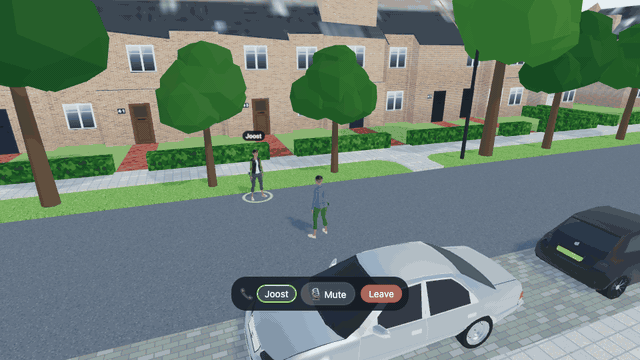

<div align="center">

# 🏘️ Toy City

**Walk the streets you once knew.**

Rotterdam, Barendrecht and Amsterdam, rebuilt house by house from open map data.<br/>
Wander the street you grew up on, send a friend a link, and meet them there. No install, no account.

[](https://toycity.pages.dev)

[](https://toycity.pages.dev)

</div>

## What you can do

- 🚶 **Walk, run and jump** through real streets: every house, hedge, canal, tree and lamp post is where it really is
- 🔎 **Find a place**: search an address, a shop or a street, or click anywhere to walk there
- 🚗 **Drive any parked car** (or hop on a motorbike): walk up and press `E`. Look through your own eyes to sit behind the wheel
- 💥 **Mind the paintwork**: crash and the car shows it; park on the pavement and you get a ticket
- 👋 **Meet people**: everyone nearby walks around as themselves. Tap someone to call them, and hear them from where they stand
- 📍 **Send a meeting link**: friends who open it arrive right next to you
- 🛩️ **Fly** above the town, 🌅 change the time of day, and 🐦 listen to the neighbourhood
- 📱 **Works on your phone** too: a joystick, a jump button, drag to look

| Keys | |
|---|---|
| `W` `A` `S` `D` or arrows | walk / drive |
| `Shift` | run / go faster |
| `Space` | jump |
| `E` | get in or out of a car |
| `V` | look through your own eyes |
| `F` | fly |
| `M` | map |

Everything is browser to browser: calls and positions go straight between players, with no game
server in between ([how it works](docs/multiplayer.md)).

---

## For developers

Toy City is a static site: pre-baked map squares streamed into a three.js scene, with
peer-to-peer multiplayer. The story behind it, including what went wrong, is in
**[How it works](docs/how-it-works.md)**; the formal design is in
**[Rendering architecture](docs/rendering-architecture.md)** and **[Multiplayer](docs/multiplayer.md)**.

```sh
# 1. Fetch and clip the open data for a town (PDOK, 3D BAG, OpenStreetMap)
python3 tilebake.py barendrecht --gemeente Barendrecht

# 2. Bake the squares and the overview
node tools/buildtiles.mjs barendrecht
node tools/overview.mjs barendrecht
tools/.venv/bin/python tools/overview_aerial.py barendrecht

# 3. Play locally
python3 tools/serve.py 8765        # then open http://127.0.0.1:8765/

# 4. Build the static site, and test
sh tools/build_site.sh             # → dist/site
node --test tests/*.test.mjs
```

**Adding a place** is one entry in [`web/places.json`](web/places.json): a name, a line about it,
the region that holds it, a start point and a photo. A new town needs baking first (steps 1–2);
for another province pass its Geofabrik extract with `--osm`, and `--bbox` keeps part of a big city.

The live version runs on Cloudflare Pages. The only moving part is a tiny Worker that hands out
short-lived TURN credentials, so players on strict mobile networks can still reach each other.

## Sources and credits

Toy City is built entirely from open data and openly licensed work. Thank you to everyone who
publishes it.

### Map data

Everything is fetched once by `tilebake.py`, clipped per 500 m square of the Dutch RD grid
(EPSG:28992) and baked into the game's own files. The browser never calls these services while
you play, except for the minimap tiles.

| Source | What it gives the game | Licence |
|---|---|---|
| [3D BAG](https://3dbag.nl) (TU Delft 3D geoinformation group) | Every building: its footprint, a simple LoD 1.2 block for the distance and the LoD 2.2 roof shape up close. Built from the Dutch building register (BAG) and the national height map (AHN). | [CC BY 4.0](https://docs.3dbag.nl/en/copyright/) |
| [BGT](https://www.pdok.nl/introductie/-/article/basisregistratie-grootschalige-topografie-bgt-), via [PDOK](https://www.pdok.nl) | The ground itself: roads, pavements, gardens, grass and water surfaces, plus hedges, walls, trees, lamp posts and street furniture. This is why every garden path and canal edge is where it really is. | [CC0](https://creativecommons.org/publicdomain/zero/1.0/) / Kadaster |
| [BAG addresses](https://www.kadaster.nl/zakelijk/registraties/basisregistraties/bag), via PDOK | House numbers and the address search index, so searching *Coolsingel 40* takes you to the right front door. | [Public Domain Mark](https://creativecommons.org/publicdomain/mark/1.0/) / Kadaster |
| PDOK [aerial photographs](https://www.pdok.nl/introductie/-/article/luchtfoto-pdok) (Beeldmateriaal Nederland) | 25 cm imagery draped over the ground and roofs near you, and lower resolution further out. | [CC BY 4.0](https://www.beeldmateriaal.nl) |
| PDOK [administrative boundaries](https://www.pdok.nl/introductie/-/article/bestuurlijke-gebieden) | Municipality outlines, which decide which squares belong to a town. | [CC BY 4.0](https://creativecommons.org/licenses/by/4.0/) / Kadaster |
| PDOK [Locatieserver](https://www.pdok.nl/introductie/-/article/pdok-locatieserver) | Finding a town or address while baking. | Free public service |
| [OpenStreetMap](https://www.openstreetmap.org/copyright), via the [Geofabrik](https://download.geofabrik.de) Zuid-Holland extract | Street names, shops and other named places, what kind of building each is (church, school…), street furniture, and bus stops (kept only when a bus route actually serves them). OSM tiles also draw the minimap. | © OpenStreetMap contributors, [ODbL](https://opendatacommons.org/licenses/odbl/) |

### 3D models

| Model | Author | Licence |
|---|---|---|
| [Generic SUV ZYX0](https://blendswap.com/blend/29795) | 1DInc | CC0 |
| [Honda VFR800](https://blendswap.com/blend/5449) | danielfc10 | CC BY |
| Zuri (persona), from [BlenderKit](https://www.blenderkit.com) | Richie Kirui | CC0 |
| Xbot (the classic figure and the shared walk, run and idle animations) | from the [three.js examples](https://github.com/mrdoob/three.js/tree/dev/examples/models/gltf) | as distributed with three.js |

Every parked car is that one SUV in its own paint (plus the odd motorbike), so the vehicles load in a
few seconds and every car opens its door. The models are simplified by `tools/blendswap_cars.py`, and
Zuri's Rigify skeleton was renamed to Mixamo bones by `tools/personas.py`, so every person shares the same animations. The
full list is in [CREDITS.txt](web/models/CREDITS.txt).

### Software and services

- [three.js](https://threejs.org) draws everything (MIT).
- [Leaflet](https://leafletjs.com) draws the minimap (BSD-2-Clause).
- [polygon-clipping](https://github.com/mfogel/polygon-clipping) merges building footprints into
  neighbourhood blocks for the overview (MIT).
- [osmium](https://osmcode.org/osmium-tool/) cuts and filters the OpenStreetMap extract (GPL-3.0,
  used only while baking).
- [Trystero](https://github.com/dmotz/trystero) connects players browser to browser over public
  [Nostr](https://nostr.com) relays (MIT). It's bundled with a small patch, see
  [multiplayer.md](docs/multiplayer.md).
- [Cloudflare Pages](https://pages.cloudflare.com) hosts the site, and
  [Cloudflare Realtime TURN](https://developers.cloudflare.com/realtime/turn/) relays calls for
  players whose networks block direct connections.
- Birds, wind, leaves and traffic are synthesised in the browser with the Web Audio API. There are
  no sound files to credit.

<div align="center"><sub>Made with stroopwafels and an unreasonable love for hedges. 🌳</sub></div>
