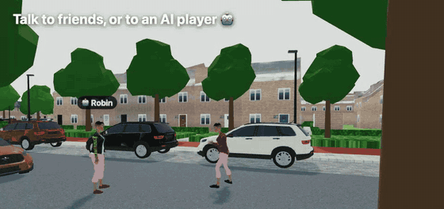
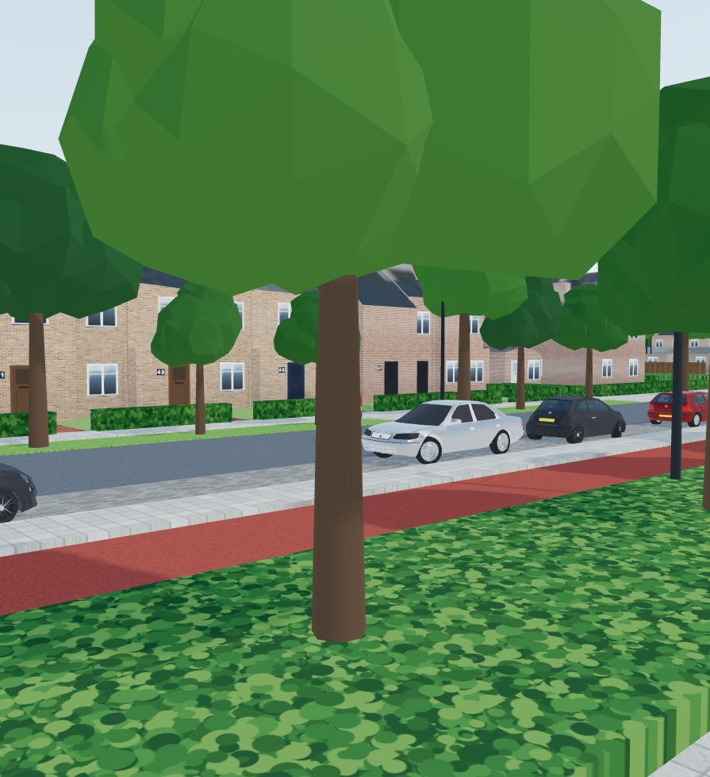
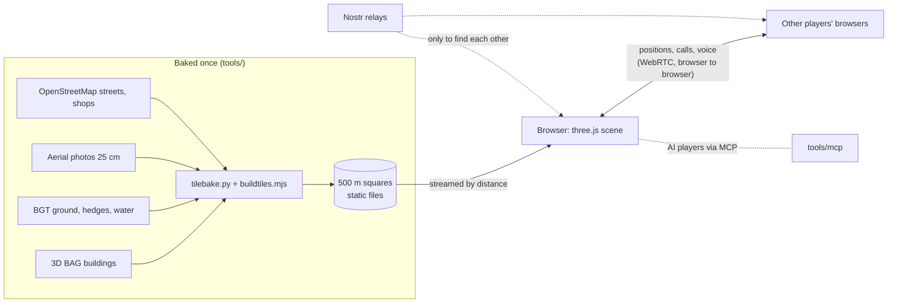

<div align="center">

# 🏘️ Toy City

**Walk the streets you once knew.**

Rotterdam, Barendrecht and Amsterdam, rebuilt house by house from open map data.<br/>
Wander the street you grew up on, send a friend a link, and meet them there. No install, no account.

[](https://toycity.pages.dev)
[](https://toycity.pages.dev/facts.html)


[](https://toycity.pages.dev)

</div>

<table>
<tr>
<td></td>
<td></td>
<td></td>
</tr>
<tr>
<td align="center"><sub>Every house, hedge and lamp post where it really is</sub></td>
<td align="center"><sub>Fly over the town, out to the horizon</sub></td>
<td align="center"><sub>Thousands of cars, each one you can drive</sub></td>
</tr>
</table>

## In numbers

| | |
|---|---|
| 🏠 **332,000** buildings, each with its real roof | 🌳 **333,000** trees where they really stand |
| 📫 **946,000** addresses you can walk to | 🛣️ **4,100 km** of drivable road, with real speed limits and one-way streets |
| 🗺️ **268 km²** of city with no loading screens | 🏪 **27,700** named places: shops, cafés, schools, bus stops |
| 🦆 Birds on the water from the **Sovon** national bird survey | 🎯 One frame of traffic, people and birds: **< 0.1 ms** |

## What you can do

### Explore
- 🚶 **Walk, run and jump** (`WASD`, `Shift`, `Space`) or **click anywhere** to walk there. Stand on hedges, benches and car roofs.
- 🔎 **Search** an address, shop or street from the ☰ menu and you are there.
- 🏊 **Swim** in canals and ponds: walk to the water and press `G`; swim onto the bank to climb out.
- 🛩️ **Fly** above the town (`F`), 🌅 change the time of day, 🗺️ open the map (`M`).
- 📱 **On your phone** too: a joystick, a jump button, drag to look.

### Drive
- 🚗 **Get into any parked car** or motorbike (`E`). Look through your own eyes (`V`) to sit behind the wheel.
- 🧭 **Autopilot**: name a place and lean back. Routes come live from OpenStreetMap, keep right and say the next turn.
- 📻 **Car radio** with real Dutch stations: NPO Radio 2, 3FM, Radio 1, Klassiek.
- 🅿️ Park in a bay and it is put away neatly; leave it on the pavement and you get a ticket.
- 🟨 Drive carefully: hit someone and they go flying, and you get a yellow card everyone can see.

### A living town
- 🚙 **Traffic and passers-by** on the real streets. Two players see **the same** cars in the same places, without a server.
- 🦢 **Swans, geese, ducks and coots** on the water, chosen by the Dutch national bird survey. Swan pairs fly in to visit other ponds.
- 🌊 Rippling water that mirrors a sky baked for the time of day.

### Meet people
- 👋 Everyone nearby walks around as themselves. **Tap someone to call them** and hear them from where they stand.
- 🧭 **Find a friend**: a route line on the pavement (or the road, if you drive) that follows them as they move.
- 📍 **Send a meeting link**: friends who open it arrive right beside you.
- 🙋 **Ride along** in a friend's passenger seat (`E` next to them).
- 🚪 **Knock on doors** (`K`) or **make a house your home** (`L`): go inside and hear it wherever you are when someone knocks.
- 🤖 **AI players** can join too, and talk with you by voice (see below).

| Keys | |
|---|---|
| `W` `A` `S` `D` or arrows | walk / drive |
| `Shift` | run / go faster |
| `Space` | jump (onto hedges, benches, car roofs) |
| `E` | get in or out of a car, or ride along with a friend |
| `G` | swim, next to water |
| `K` | knock on the door in front of you |
| `L` | make the house in front of you your home, or go inside it |
| `V` | look through your own eyes |
| `F` | fly |
| `M` | map |

## How it works, in one picture



- **No game server.** The town is a set of static files on Cloudflare Pages. Players find each other through public Nostr relays (only connection set-up passes there) and then talk straight from browser to browser over WebRTC. A tiny Worker hands out relay credentials for strict networks.
- **The same world for everyone, without syncing it.** Traffic, passers-by and birds are a pure function of the clock and a seed: every browser computes the same car at the same spot. A car that stops for you stops for your friend too, because both browsers know where you are.
- **Fast on purpose.** Squares stream in by distance in workers, uploads fit in a per-frame budget, shadows only redraw when something moves, birds and parked cars are drawn in batches.

The full story, including what went wrong along the way: **[How it works](docs/how-it-works.md)** ·
module map: **[Architecture](docs/architecture.md)** · **[Multiplayer](docs/multiplayer.md)** ·
**[Rendering architecture](docs/rendering-architecture.md)**.

---

## Bring your AI agent

[`tools/mcp`](tools/mcp) is an MCP server that lets an AI agent (Claude, or any MCP client) join the map
as a player marked 🤖. It walks, drives, follows a friend and knocks on doors under the same limits as
a person: no running faster, no jumping across town, one move a second. With a voice it holds a
real conversation: it speaks in a natural voice, hears you as text, and stops when you interrupt it.
It picks up what you said about 0.8 s after you stop talking.

### Install it in your agent harness

Needs Node.js 22+ and Chrome or Chromium. Install the skill for your harness (`-g` makes it available
in every project):

| Harness | Command |
|---|---|
| Claude Code | `npx skills add sarathsp06/toycity -g -a claude-code` |
| Codex | `npx skills add sarathsp06/toycity -g -a codex` |
| Cursor | `npx skills add sarathsp06/toycity -g -a cursor` |
| Gemini CLI | `npx skills add sarathsp06/toycity -g -a gemini-cli` |
| OpenCode | `npx skills add sarathsp06/toycity -g -a opencode` |
| Any other ([list](https://github.com/vercel-labs/skills/blob/main/docs/agents.md)) | `npx skills add sarathsp06/toycity` and pick it |

Then ask your agent: *"Visit Barendrecht in Toy City and tell me who you meet."* The first time, the
skill has the agent install the game connection (the MCP server in [`tools/mcp`](tools/mcp)) and asks
you to restart it once.

To set up the MCP server by hand instead:

```sh
git clone --depth 1 https://github.com/sarathsp06/toycity ~/.toycity
npm install --prefix ~/.toycity/tools/mcp
```

| Harness | Register the server |
|---|---|
| Claude Code | `claude mcp add -s user toycity -- node ~/.toycity/tools/mcp/server.mjs` |
| Codex | `codex mcp add toycity -- node ~/.toycity/tools/mcp/server.mjs` |
| Gemini CLI | `gemini mcp add toycity node ~/.toycity/tools/mcp/server.mjs` |
| oh-my-pi (omp) | add `"toycity": { "command": "node", "args": ["/Users/you/.toycity/tools/mcp/server.mjs"] }` under `mcpServers` in `~/.omp/agent/mcp.json` |
| Cursor, Claude Desktop, others | add `"toycity": { "command": "node", "args": ["/Users/you/.toycity/tools/mcp/server.mjs"] }` under `mcpServers` in their MCP config (Cursor: `~/.cursor/mcp.json`) |

Full tool list and limits: [tools/mcp/README.md](tools/mcp/README.md).

## For developers

Toy City is a static site: pre-baked map squares streamed into a three.js scene, with
peer-to-peer multiplayer. The story behind it, including what went wrong, is in
**[How it works](docs/how-it-works.md)**; the module map is in **[Architecture](docs/architecture.md)**; the formal design is in
**[Rendering architecture](docs/rendering-architecture.md)** and **[Multiplayer](docs/multiplayer.md)**.

```sh
# 1. Fetch and clip the open data for a town (PDOK, 3D BAG, OpenStreetMap)
python3 tilebake.py barendrecht --gemeente Barendrecht

# 2. Bake the squares and the overview
node tools/buildtiles.mjs barendrecht
node tools/overview.mjs barendrecht
tools/.venv/bin/python tools/overview_aerial.py barendrecht

# 3. Play locally
python3 tools/serve.py 8765        # then open http://127.0.0.1:8765/

# 4. Build the static site, and test
sh tools/build_site.sh             # → dist/site
cd tests && node --test           # the game and multiplayer (79 tests)
cd tools/mcp && node --test *.test.mjs   # the AI player (21 tests)
```

**Adding a place** is one entry in [`web/places.json`](web/places.json): a name, a line about it,
the region that holds it, a start point and a photo. A new town needs baking first (steps 1–2);
for another province pass its Geofabrik extract with `--osm`, and `--bbox` keeps part of a big city.

The live version runs on Cloudflare Pages. The only moving part is a tiny Worker that hands out
short-lived TURN credentials, so players on strict mobile networks can still reach each other.

## Sources and credits

Toy City is built entirely from open data and openly licensed work. Thank you to everyone who
publishes it.

### Map data

Everything is fetched once by `tilebake.py`, clipped per 500 m square of the Dutch RD grid
(EPSG:28992) and baked into the game's own files. The browser never calls these services while
you play, except for the minimap tiles, and the place search and route planner the autopilot asks.

| Source | What it gives the game | Licence |
|---|---|---|
| [3D BAG](https://3dbag.nl) (TU Delft 3D geoinformation group) | Every building: its footprint, a simple LoD 1.2 block for the distance and the LoD 2.2 roof shape up close. Built from the Dutch building register (BAG) and the national height map (AHN). | [CC BY 4.0](https://docs.3dbag.nl/en/copyright/) |
| [BGT](https://www.pdok.nl/introductie/-/article/basisregistratie-grootschalige-topografie-bgt-), via [PDOK](https://www.pdok.nl) | The ground itself: roads, pavements, gardens, grass and water surfaces, plus hedges, walls, trees, lamp posts and street furniture. This is why every garden path and canal edge is where it really is. | [CC0](https://creativecommons.org/publicdomain/zero/1.0/) / Kadaster |
| [BAG addresses](https://www.kadaster.nl/zakelijk/registraties/basisregistraties/bag), via PDOK | House numbers and the address search index, so searching *Coolsingel 40* takes you to the right front door. | [Public Domain Mark](https://creativecommons.org/publicdomain/mark/1.0/) / Kadaster |
| PDOK [aerial photographs](https://www.pdok.nl/introductie/-/article/luchtfoto-pdok) (Beeldmateriaal Nederland) | 25 cm imagery draped over the ground and roofs near you, and lower resolution further out. | [CC BY 4.0](https://www.beeldmateriaal.nl) |
| PDOK [administrative boundaries](https://www.pdok.nl/introductie/-/article/bestuurlijke-gebieden) | Municipality outlines, which decide which squares belong to a town. | [CC BY 4.0](https://creativecommons.org/licenses/by/4.0/) / Kadaster |
| PDOK [Locatieserver](https://www.pdok.nl/introductie/-/article/pdok-locatieserver) | Finding a town or address while baking. | Free public service |
| [OpenStreetMap](https://www.openstreetmap.org/copyright), via the [Geofabrik](https://download.geofabrik.de) Zuid-Holland extract | Street names, shops and other named places, what kind of building each is (church, school…), street furniture, and bus stops (kept only when a bus route actually serves them). OSM tiles also draw the minimap. The drivable streets, one-way streets and speed limits also make the autopilot's offline route network. | © OpenStreetMap contributors, [ODbL](https://opendatacommons.org/licenses/odbl/) |
| [Valhalla](https://github.com/valhalla/valhalla) on OpenStreetMap, run by [FOSSGIS](https://www.fossgis.de) at valhalla1.openstreetmap.de | The autopilot's routes, for a car or a motorbike, with turn-by-turn directions. | Free public service; © OpenStreetMap contributors |
| [Sovon Vogelonderzoek Nederland](https://portal.sovon.nl/atlas/soorten) | Which birds you meet on the water: the share of the country's 5 × 5 km squares where each species breeds (Vogelatlas, 2013–2015). Every number is on the [Facts page](https://toycity.pages.dev/facts.html). | © Sovon, used as published figures |
| [Nominatim](https://nominatim.org) on openstreetmap.org | Autopilot destinations the game's own search index doesn't know. | Free public service; © OpenStreetMap contributors |

### 3D models

| Model | Author | Licence |
|---|---|---|
| [Generic SUV ZYX0](https://blendswap.com/blend/29795) | 1DInc | CC0 |
| [Honda VFR800](https://blendswap.com/blend/5449) | danielfc10 | CC BY |
| Zuri (persona), from [BlenderKit](https://www.blenderkit.com) | Richie Kirui | CC0 |
| Xbot (the classic figure and the shared walk, run and idle animations) | from the [three.js examples](https://github.com/mrdoob/three.js/tree/dev/examples/models/gltf) | as distributed with three.js |
| Goose, Mallard duck (low-poly birds) | [Poly by Google](https://poly.pizza) | CC BY 3.0 |
| [Universal Animation Library](https://quaternius.com/packs/universalanimationlibrary.html) (jumping, sitting, riding, falling, knocking, talking, crouching, dancing, swimming) | Quaternius | CC0 |

Every parked car is that one SUV in its own paint (plus the odd motorbike), so the vehicles load in a
few seconds and every car opens its door. The models are simplified by `tools/blendswap_cars.py`, and
Zuri's Rigify skeleton was renamed to Mixamo bones by `tools/personas.py`, so every person shares the same animations; `tools/retarget_anims.mjs` puts the Quaternius clips on that skeleton (`web/models/anims.glb`). The
full list is in [CREDITS.txt](web/models/CREDITS.txt).

### Software and services

- [three.js](https://threejs.org) draws everything (MIT).
- [Leaflet](https://leafletjs.com) draws the minimap (BSD-2-Clause).
- [polygon-clipping](https://github.com/mfogel/polygon-clipping) merges building footprints into
  neighbourhood blocks for the overview (MIT).
- [osmium](https://osmcode.org/osmium-tool/) cuts and filters the OpenStreetMap extract (GPL-3.0,
  used only while baking).
- [Trystero](https://github.com/dmotz/trystero) connects players browser to browser over public
  [Nostr](https://nostr.com) relays (MIT). It's bundled with a small patch, see
  [multiplayer.md](docs/multiplayer.md).
- [Cloudflare Pages](https://pages.cloudflare.com) hosts the site, and
  [Cloudflare Realtime TURN](https://developers.cloudflare.com/realtime/turn/) relays calls for
  players whose networks block direct connections.
- Birds, wind, leaves and traffic are synthesised in the browser with the Web Audio API. There are
  no sound files to credit.
- The car radio plays the public live streams of [NPO](https://www.npo.nl) Radio 1, Radio 2, 3FM and Klassiek.
- AI players speak with [Kokoro](https://github.com/thewh1teagle/kokoro-onnx) and listen with
  [whisper.cpp](https://github.com/ggml-org/whisper.cpp), both running on your own computer.

## Licence

The code is [MIT](LICENSE). Map data and models keep their own licences, listed above.

<div align="center"><sub>Made with stroopwafels and an unreasonable love for hedges. 🌳</sub></div>
