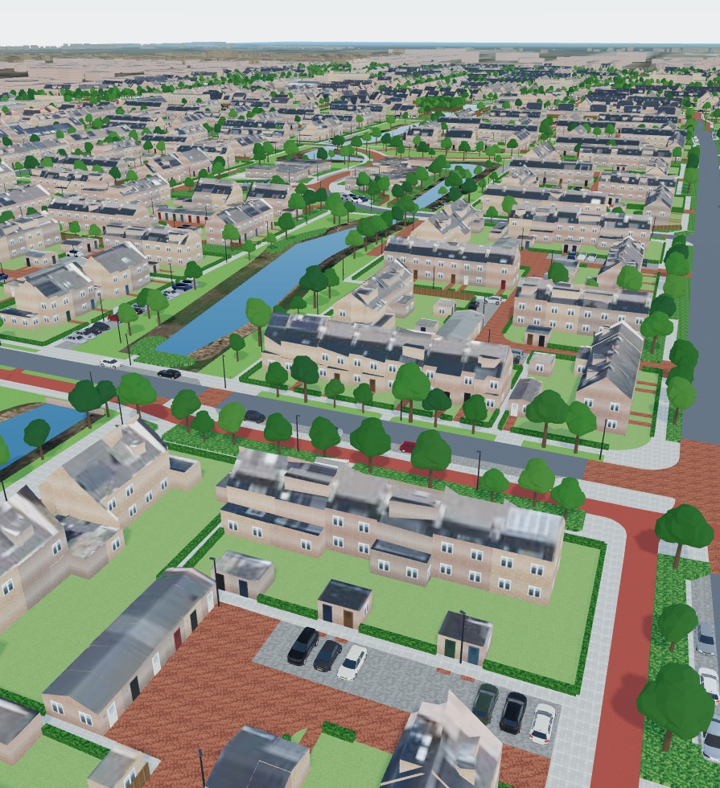
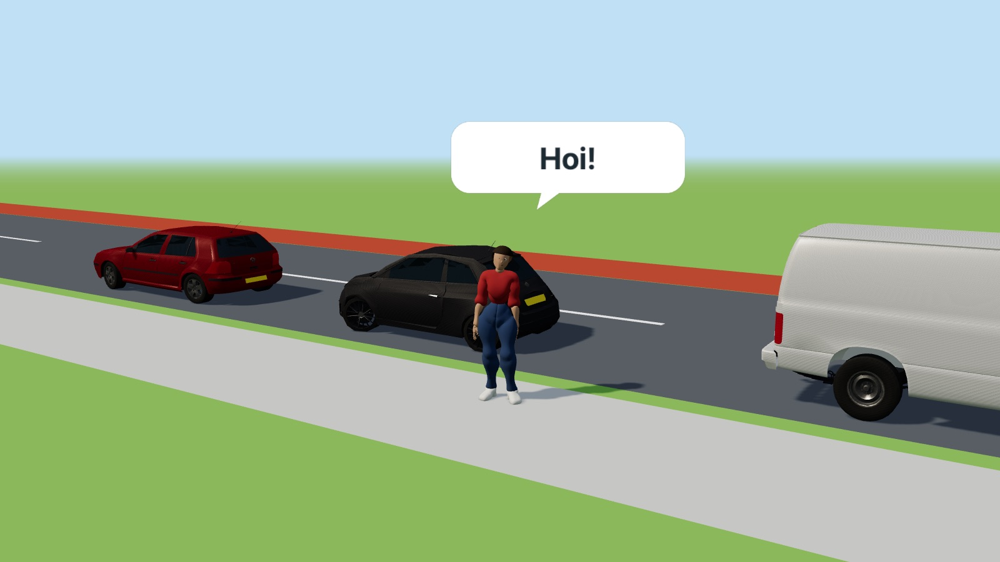
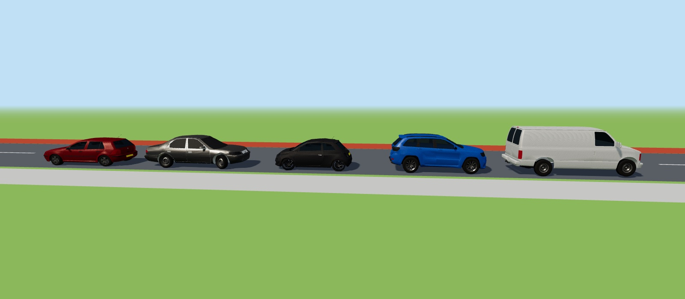
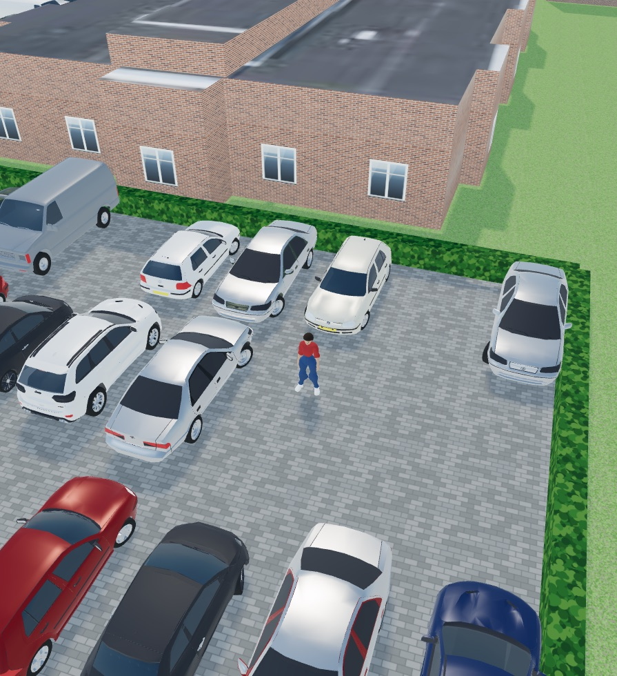

<div align="center">

# 🏘️ Toy City

**Walk the streets you once knew. In your browser. At 75 fps.**

A real Dutch town, every house, hedge, canal and parked car, rebuilt from open map data<br/>
and streamed into a tiny three.js world you can walk, run, jump and drive through.

### ▶ [Play it at toycity.pages.dev](https://toycity.pages.dev)



</div>

---

## Meet the locals



Our hero says *hoi* to everyone. They have walked past a lot of parked cars, and they have
opinions about every one of them:



| | Car | Triangles up close | The hero's opinion |
|---|---|---|---|
| 🔴 | VW Golf | 30,000 | "Every street has one. It is the law." |
| ⚪ | Toyota Camry | 30,000 | "Will outlive us all." |
| ⚫ | Fiat 500 | 15,000 | "Refused to be simplified. We respect that." |
| 🔵 | Jeep Cherokee | 30,000 | "Bold choice for a street 4 metres wide." |
| 🤍 | The van | 30,000 | "Someone is always moving house." |

Paint is chosen per parking spot, so five models fill a town of thousands of parked cars without anyone
noticing. Probably.

## What you can do

- 🚶 **Walk, run and jump** (yes, onto hedges; no, not through trees)
- 🖱️ **Click anywhere** and walk there, or **search an address** like *Schaatsbaan 43*
- 🛩️ **Fly** (press `F`) high above the town and drop back in anywhere
- 🌅 **Change the time of day**, from morning to golden hour to night
- 📱 **Play on your phone** with a joystick, a jump button, drag to look and pinch to zoom
- 👋 **Meet people**: other players show up within 10 m with their name above their head. Turn on your mic and anyone within a few metres hears you, from the direction you're standing in. It's all browser to browser, with no server of ours ([how](docs/multiplayer.md))
- 🐦 **Hear the neighbourhood**: birds where it's green, traffic near busy streets, all made in the browser

| Keyboard | |
|---|---|
| `W` `A` `S` `D` / arrows | walk |
| `Shift` | run |
| `Space` | jump |
| `F` | fly |
| drag / scroll | look / zoom |



## Why it's fast

The browser never touches raw map data. Everything is baked ahead of time into tiny files that
go almost straight to the GPU:

- 🧱 **500 m squares on the Dutch RD grid**, at three levels of detail, plus a **2 km overview** that
  fills the view to the horizon, so you never see an empty hole
- 🔮 **Looks 4 seconds ahead** of where you're heading, and fetches that first
- 🧵 **Two background workers** download and unpack, and the page spends at most 6 ms per frame
  uploading
- 🚗 **Thousands of instanced cars and trees**, with detailed cars only right next to you
- 💾 **Remembers what you've seen**: a revisit loads in about 1 s instead of about 9 on mobile

| Simulated mobile connection | Before | After |
|---|---|---|
| Empty patches at 100 m/s | 16.4 % of the time | **0 %** |
| Missing detail at 100 m/s | 65.8 % | **10.5 %** |
| Missing detail at 30 m/s | 4.1 % | **0 %** |

The whole story, including what went wrong, is in **[How it works](docs/how-it-works.md)**. The
formal design is in **[Rendering architecture](docs/rendering-architecture.md)**.


## Build it yourself

```sh
# 1. Fetch and clip the open data for a town (PDOK, 3D BAG, OpenStreetMap)
python3 tilebake.py barendrecht --gemeente Barendrecht

# 2. Bake the squares and the overview
node tools/buildtiles.mjs barendrecht
node tools/overview.mjs barendrecht
tools/.venv/bin/python tools/overview_aerial.py barendrecht

# 3. Play locally (no caching, so no ?v= hacks)
python3 tools/serve.py 8765        # then open http://127.0.0.1:8765/city.html

# 4. Make the static site
sh tools/build_site.sh             # → dist/site, ready for any static host
```

Handy test switches: `city.html?drive=100&net=80,20` drives through town at 100 m/s on a
simulated slow connection and reports the gaps, and `?touch=1` shows the phone controls on a
desktop.

## Hosting

It's just files. The live version runs on **Cloudflare Pages**: no server and no database. A code
change re-uploads only the files that changed.

## Coming soon™

- 🗣️ **Crowds**: an SFU for when more than a handful of people meet in one place
- 🏙️ **Rotterdam**: 688 more squares
- 🚙 **More cars**: a Skoda Superb, a VW Passat and a BMW 5 GT are waiting in the garage
- 🦆 Ducks in the canals (not promised, but strongly hoped for)

## Credits

Map data © [PDOK](https://www.pdok.nl) / Kadaster, [3D BAG](https://3dbag.nl) (TU Delft) and ©
[OpenStreetMap](https://www.openstreetmap.org/copyright) contributors. Car models from
[BlendSwap](https://blendswap.com); authors and licences are in
[CREDITS.txt](web/models/CREDITS.txt). Rendered with [three.js](https://threejs.org).

<div align="center"><sub>Made with stroopwafels and an unreasonable love for hedges. 🌳</sub></div>
