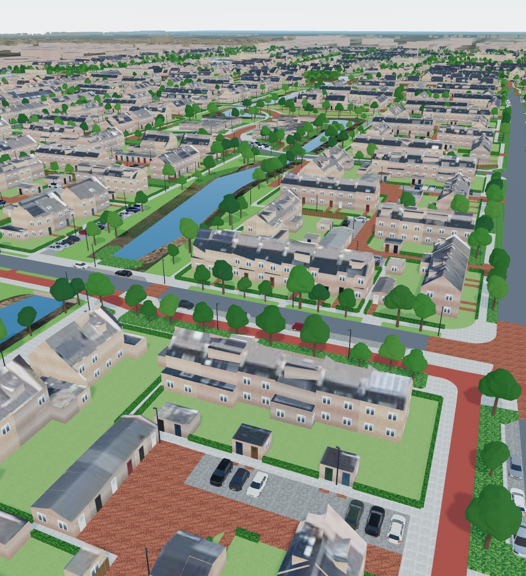
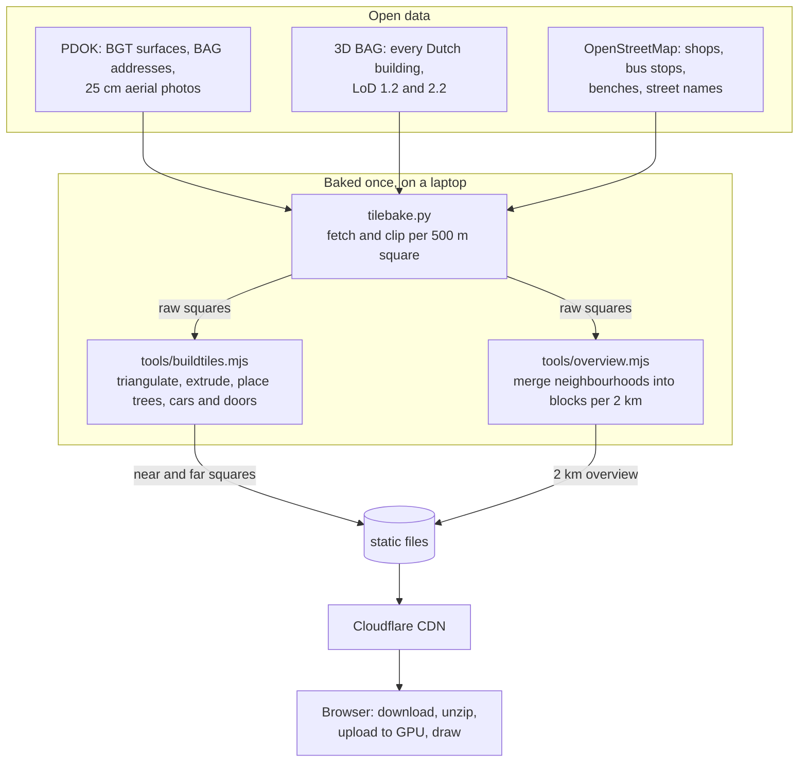
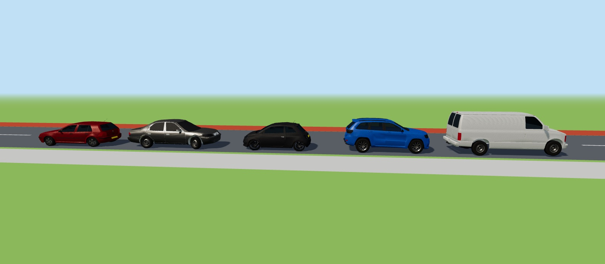
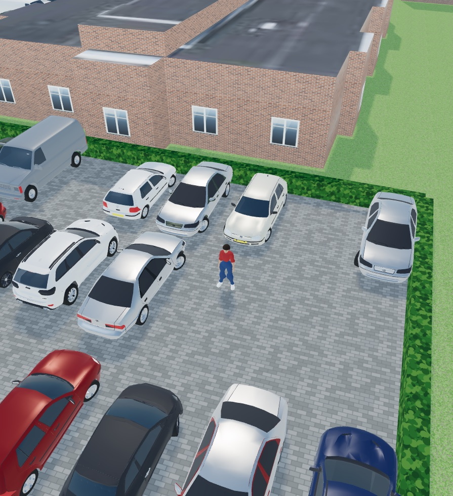
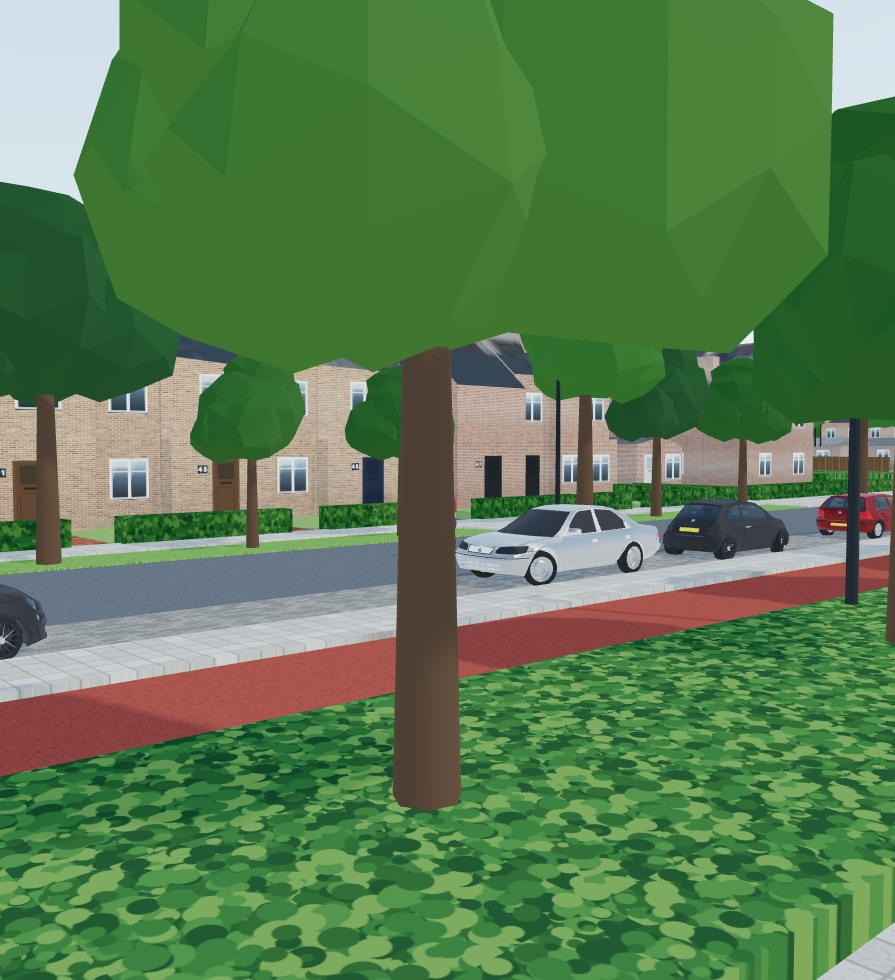
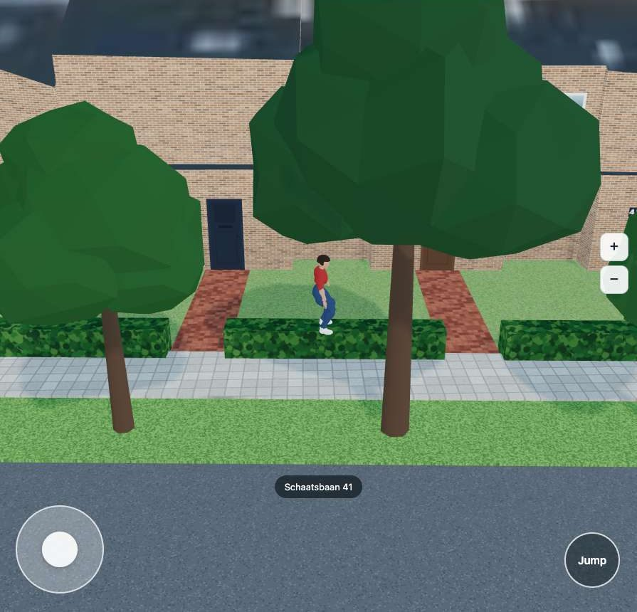

# How Toy City works, and what we learned building it

This is the engineering story behind [toycity.pages.dev](https://toycity.pages.dev): how a real Dutch
town ends up as a 3D world in a browser tab at 75 frames per second, and the tricks that got it
there. The formal design (quadtree, schemas, comparison with Cesium 3D Tiles) lives in
[rendering-architecture.md](rendering-architecture.md). This page covers the *why* and the
lessons learned.



---

## 1. The big idea: do all the hard work before anyone presses play

The browser never sees raw map data. No OpenStreetMap XML, no building footprints, no
triangulation. Everything that can be computed ahead of time is computed ahead of time, on a
laptop, and saved as files that a GPU can swallow almost directly.



**Lesson:** the cheapest work in the browser is work it never has to do. Triangulating, clipping
and placing a whole 500 m square is real CPU work. Doing that in the browser while someone drives
at 100 km/h would be a stutter fest.

## 2. Small, boring, fast file formats

Every square is three gzip files: near buildings (`b`), near detail (`d`) and far blocks (`f`).
Inside each is a small JSON header followed by raw typed arrays:

| What | Stored as | Why |
|---|---|---|
| Positions | `Uint16`, 2 cm steps, offset so they stay positive | a third of the size of `float32`, and 2 cm is invisible |
| Normals | `Int8` ×4 (the fourth byte is spare, later reused) | 4 bytes instead of 12 |
| Indices | `Uint16` when a mesh has fewer than 65,536 vertices | half the size |
| Repeated objects | one row per item: `[x, up, z, rotation, scale, colour]` | a tree is 24 bytes, not 2,000 triangles |

The page puts the quantisation back with a single `position` and `scale` on a parent group, so
the GPU does the unpacking for free.

**Lesson:** we looked hard at glTF, meshoptimizer and Cesium 3D Tiles (see the comparison table
in the architecture doc). For our own tiles, plain typed arrays win: there is nothing to parse.
glTF is still perfect for hand-made models like the cars and the person.

## 3. Nothing heavy on the main thread

Two Web Workers download, un-gzip (`DecompressionStream`) and parse every file, and decode the
aerial photos with `createImageBitmap`. Then they *transfer* the buffers to the page, which
hands ownership over without copying anything. The page only does two things: it creates GPU
buffers, and it never spends more than 6 ms per frame doing that. Anything left waits for the
next frame.

**Lesson:** a dropped frame comes from one big job, not many small ones. A per-frame time budget
is the easiest stutter fix there is.

## 4. A quadtree that is just the Dutch grid

The Netherlands has its own metric coordinate system, RD New (EPSG:28992). A 500 m square is
simply `floor(x / 500), floor(y / 500)`, and its parent is that divided by four. No tree to build,
store or walk.

| Level | Size | What you see | Distance |
|---|---|---|---|
| near | 500 m | detailed roofs, doors and windows, hedges, trees, cars, collision | up to 200 m |
| far | 500 m | simple blocks | up to 1.1 km |
| overview | 2 km | whole neighbourhoods merged into blocks, 2 m aerial mosaic | to the horizon |

**Lesson:** use the coordinate system the data already speaks. The page picks one origin near
the player, so `float32` precision stays at millimetres even though RD numbers are in the hundreds
of thousands.

## 5. The overview layer: never show an empty hole

The best trick in the project. Every 2 km of town is pre-merged into blocks: footprints of similar
height are unioned (so a row of 12 terraced houses becomes one block), simplified to 1.5 m and
extruded with a flat roof. All of Barendrecht comes out at **2 MB and 180,000 triangles, built
in 2 seconds**.

It is always drawn underneath everything. When a detailed 500 m square finishes loading, the
overview has to get out of the way for exactly that square. Every overview vertex remembers which
of its 16 squares it belongs to, and one 16-bit number tells the vertex shader which squares to
collapse to nothing:

```glsl
if (((uHide >> int(sq + 0.5)) & 1) == 1) transformed = vec3(0.0);
```

One draw call per 2 km, an exact hand-over per square, and no gaps. The overview ground sits 40 cm
below the detailed ground so the two never flicker against each other.

**Lesson:** a "parent fallback" doesn't need fancy cross-fades to feel solid. It needs to *always
be there*.

## 6. Loading for someone driving fast

Loading "everything near me" works when you walk. In a car it means the road ahead is always the
last thing to arrive. So the loader:

1. **Predicts the next 4 seconds** from a smoothed velocity, and treats squares along that path
   as if they were close.
2. **Ranks by "how soon will I be there"**: metres still to travel plus the distance from that
   point. A square behind the camera gets a penalty, and an empty square beats an upgrade.
3. **Keeps squares a bit longer than it needs to** (80 m extra for near, 160 m for far), so driving
   along a boundary doesn't load and unload the same square over and over.
4. **Cancels downloads that stopped mattering**, inside the worker with an `AbortController`.
   One exception: a far file already on its way is kept, because 200 kB that fills a gap is a
   bargain.
5. **Never runs more than 4 downloads at once**, so the important ones aren't starved.

We measured it instead of guessing. `city.html?drive=100&net=80,20` drives in a straight line at
100 m/s over a simulated 80 ms / 20 Mbit/s connection and counts gaps:

| | 30 m/s before | 30 m/s after | 100 m/s before | 100 m/s after |
|---|---|---|---|---|
| Time with an empty patch nearby | 1.3 % | **0 %** | 16.4 % | **0 %** |
| Time without full detail around you | 4.1 % | **0 %** | 65.8 % | **10.5 %** |
| Slowest frame | 40 ms | **28 ms** | 41 ms | 42 ms |

**Lesson:** build the benchmark first. Two numbers (gaps and worst frame) settled every argument
about priorities.

## 7. Caching: fast for players, painless for developers

- Workers keep every downloaded file in the browser's **Cache Storage**, in a cache named after the
  region's build stamp. A new bake makes a new cache and the old one is deleted. On a mobile
  connection a revisit loads in **about 1 second instead of about 9**.
- On the local dev server this cache is **off** (unless `?cache=1`), and the dev server sends
  `no-cache`. Nobody ever has to type `?v=123` again.
- On Cloudflare, `/`, `tiles.json`, HTML and JS (including `/mp/*`) are always revalidated, and
  everything else is cached for a day.
- `/` was missing from that list once. Chrome kept an old page and ran it against new scripts; the
  game stopped at 45 % with "Cannot set properties of null (setting 'onclick')" while Brave and
  phones worked. Now `city.js` notices an old page (a button it expects is missing) and reloads
  once, keeping the URL's parameters, and every button handler checks that its button exists.
- If loading stalls, the loading screen says why: WebGL is off, a script failed, or a CDN is
  blocked. Leaflet (the minimap) loads after the game, so a blocked map CDN can't hold it up.

**Lesson:** a cache that can go stale will go stale, during a demo. Tie the cache name to the data
version and it can't. And revalidate the page itself, not just the files it loads.

## 8. Thousands of parked cars at 75 fps

Barendrecht has thousands of parked cars (about 1,800 in a typical view). They are real models from BlendSwap (a Golf, a
Camry, a Fiat 500, a Jeep Cherokee and a van), converted by a headless Blender script:



- **Every material is sorted into eight clean categories** by its name: paint, glass, tyre, metal,
  trim, headlight, taillight and a yellow Dutch number plate. Paint is white in the file and gets
  its colour per car in the game, so five models look like a hundred.
- **Every car is scaled to its real length, then corrected to its real height.** Some downloads
  were 40 % too tall.
- **Three versions**: about 30,000 triangles within 25 m, about 5,000 within 70 m, and a simple box
  car beyond that. Every 0.3 s each parked car is re-sorted into the right version, all through
  `InstancedMesh`, so the whole fleet is a few dozen draw calls.

Lessons, mostly painful:

- At 900 triangles a Golf stops being a Golf and becomes modern art. 5,000 is the floor for
  "a car" at 70 m.
- The Fiat 500's simple version fell apart, so the Fiat just uses its 15k version for both.
  Sometimes the honest fix is "don't".
- Headless Blender can't run most editor operators. Decimate through the dependency graph instead,
  and create materials *after* opening the file, because opening a file wipes them.
- To find the car body in a messy file, name an anchor object and keep parts near it. Then throw
  out flat sheets (studio floors) and anything over 8 % wider than the body (a backdrop that once
  made the Fiat two metres wide).



## 9. Little things that make it feel like a real place

- **Doors face the street.** A wall gets a front door only when public ground lies in front of it,
  not a private garden.
- **Bus stops are only where a bus actually stops.** OpenStreetMap had a stop on the Schaatsbaan
  that no line serves. Now only the 99 stops on a real route are kept.
- **Hedges are 1.1 m tall and you can jump onto them.** Trees, cars, lamp posts, benches and other
  people are solid (see below).
- **Address search** goes through a pre-built index, so typing "Schaatsbaan 43" needs no server.



*Yes, the camera is inside a hedge. In the Netherlands this is called "a normal Tuesday".*

### Solid things

There are two kinds of solid, and one question: "does a circle of radius r at (x, z) touch anything?"

- **Baked:** buildings, walls, water and hedges are rasterised into each near square's collision
  bitmap when the square is baked.
- **Footprints:** everything else is a footprint in one registry, `web/solids.js`: a circle
  `{x, z, r}` or a turned box `{x, z, hx, hz, yaw}`. The size of each kind of object (car, tree
  trunk, lamp, bollard, bench, bin, postbox, bus stop) is written down once, in `FOOTPRINTS`, and
  scaled by the instance. A square registers its footprints when it loads and drops them when it
  unloads. Other players are a *live* source: a function asked on every test, because they move.
  Footprints sit in an 8 m grid, so a test looks at a handful of cells, not thousands of cars.

`blocked()` in `city.js` asks the bitmap, then the registry. Flying ignores both.

**Lesson:** one list of shapes and one test. Making a new kind of thing solid is one line in
`FOOTPRINTS`, not another special case in the movement code.

### Driving

Any parked car can be driven (`web/vehicle.js`). Getting in hides that parked instance and switches
off its footprint in the solids registry; the car becomes a child of the player, so streaming, the
camera and multiplayer keep following the player as before. Steering is a bicycle model (heading
changes by speed × tan(steer) / wheelbase), with less steering at speed. Collision counts how many
of eight points around the body touch the bitmap or a footprint: a move must touch nothing, or less
than now, so a car parked bumper to bumper can always back out but never drive into a hedge. Other
players receive `model:colour` in the state message and draw the car instead of the person.
A passenger sends `ride:0`: others hide them, and their own game seats them in the driver's car.

The autopilot (`web/autopilot.js`) plans with OpenStreetMap's Valhalla router (FOSSGIS's public
server), asking for the vehicle you are in: `auto` for a car, `motorcycle` for the bike. That gives
one-way streets, turn restrictions, access rules, turn-by-turn directions and the expected time per
stretch, which sets the cruising speed. When the router can't be reached, or its route leaves the
squares the region has, the game plans offline: `tools/roadgraph.mjs` turns every drivable
OpenStreetMap way into `regions/<slug>/roads.json` (nodes in RD half-metres; each segment carries
which directions are allowed, whether cars and motorbikes may use it, and the speed limit), and an
A* search on travel time runs over it. A destination comes from the region's search index (every
address, place and street; the nearest of a chain), then Nominatim, or a click on the map.

The route is moved 1.5 m to the right of the road's centre line (the Netherlands drives on the
right), less in corners and fading out at both ends. The car steers towards a point a few metres
along it (pure pursuit) and slows down where it bends. On autopilot only buildings, water and hedges
stop the car, not parked cars or people. When it is stuck it backs up with the wheel the other way,
and after a few tries hops to the next point of the route, so a trip always finishes. Any steering
or throttle takes the wheel back.

Cars are right-hand drive: the SUV model is left-hand drive, so the car you drive gets its dashboard
mirrored, and the eyes, the driver's door and the getting-out side are on the right. A passenger sits
on the left; other players' games seat them in the car nearest to where they are (`presence.js`).

A bump faster than 16 km/h turns the car into its wreck, and the parked car it hit too (a wreck mesh
stands in for that instance, and stays when the car you dropped goes back to its spot). Driving into
a person faster than walking pace sends them a `hit` message: their own game flings them along the
car's direction, lays them flat for a few seconds and stands them up, and everyone sees it through
the state message (pose and height). The driver gets a card shown over their car or head, yellow
then red, for three minutes.

### Doors and homes

Front doors near you are a real model (`tools/door_model.py` builds `models/door.glb` in Blender:
frame, step, panelled leaf with window, handle and letterbox, hinged so it swings in). At a door you
can knock (`K`) or make it your home (saved in this browser). Each home is a small multiplayer room
named after the door's RD position, so a knock reaches its residents wherever they are, with a system
notification when the tab is in the background. At your own door you can go inside: the door opens,
you step through and others stop seeing you; "Step outside", or answering a knock, walks you out.

From the driver's seat (`V` while driving) the camera's near plane drops from 0.5 m to 6 cm and
the lens widens, so the dashboard and steering wheel aren't clipped away; the car you drive gets
nearly clear glass and a lighter cabin trim, and its interior is exported at higher detail.

## 10. Phones

On a touch screen the page swaps keyboard hints for a joystick (push it to the edge to run), a
Jump button, drag-to-look and pinch-to-zoom. The minimap is left out on phones: it was taking a
quarter of the screen. Each finger is tracked by its pointer id, so turning the camera with one
thumb while walking with the other doesn't make the view spin.



## 11. Shipping: just files

The site is a folder. `tools/build_site.sh` collects the game page, scripts, models and one region:
`REGION=…`, default `rotterdam`, which is Rotterdam and Barendrecht together (670 squares, about
1.2 GB, 3,470 files). `ZIP=1` also makes a zip. `tools/pages_upload.mjs` uploads it to Cloudflare
Pages, skipping every file Cloudflare already has (it compares content hashes), so a code change
uploads 3 files instead of 3,470.

A deployment is a manifest (path → hash) of *every* file. For a code change we take the previous
deployment's manifest, replace the hashes of the files that changed, and post that as the new
deployment. The first full Rotterdam manifest was too big to send in one go, so it went through a
temporary KV namespace in chunks, deleted afterwards. Upload tokens are written to a private
temporary file and removed after use; nothing secret lives in the repository.

Adding Amsterdam (403 squares, 2,087 new files) needed the same trick at a bigger size: the API
side can only reach Cloudflare's own API, not the web, so the list of new file hashes went to a
temporary KV namespace in four checksummed pieces, was merged there into the previous deployment's
manifest, and the namespace was deleted afterwards.

**Lesson:** when your files are named by content, deploys are cheap and rollbacks are free.

## Multiplayer

Players meet browser to browser, with calls by tapping someone. The whole design, and what broke
on the way (relays, TURN, where the listener's ears are), is in [multiplayer.md](multiplayer.md).

## 12. What's next

- **meshoptimizer compression** on top of the current quantisation, probably 30–50 % smaller
  geometry.
- **An 8 km level and a lazy index** per 8 km, needed before baking beyond Rotterdam.
- **Search that prefers the nearest match**: some street names (the Schaatsbaan) exist in both
  Barendrecht and Rotterdam, and search can jump across the city.
- **Look-ahead that adapts to the connection**: on a slower line, look further ahead.
- **An SFU for crowds** (see [multiplayer.md](multiplayer.md)), and more and better-looking
  open-licence people.

## Credits

Map data © PDOK / Kadaster, 3D BAG (TU Delft) and © OpenStreetMap contributors. Car models from
BlendSwap; see [CREDITS.txt](../web/models/CREDITS.txt) for authors and licences. The person is
based on three.js' Xbot, dressed in Blender.
