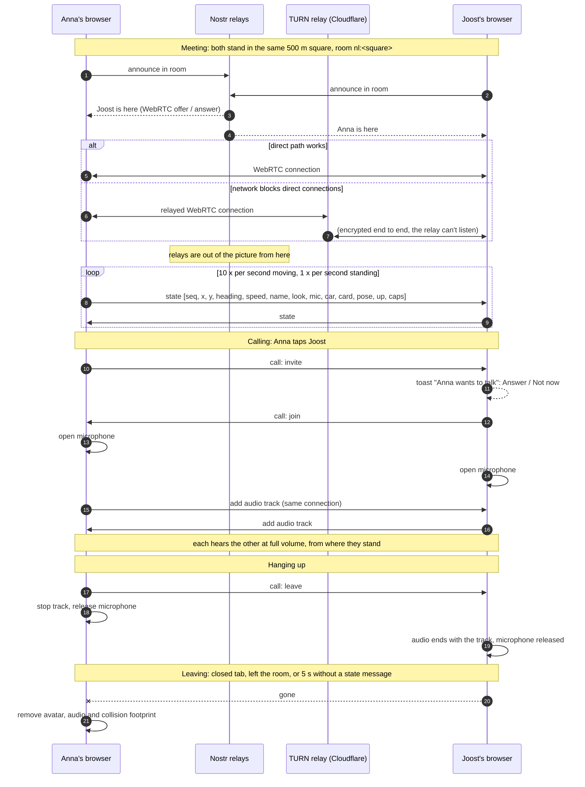

# Multiplayer: seeing and hearing each other

Status 2026-11-20: live on toycity.pages.dev and tested between a phone on a mobile network and a computer. There is no server of our own: the site is still only static files.

## Three independent systems

| System | Code | Knows about |
|---|---|---|
| Geographic streaming | `web/city.js` | buildings, roads and terrain. Nothing about other players. |
| Multiplayer presence | `web/mp/presence.js`, `players.js`, `state.js` (wire codec), `room.js` (named rooms) | who is around, positions, names, personas and call messages. Nothing about audio or the map. |
| Spatial audio | `web/mp/voice.js` (voice), `web/mp/ambience.js` (environment) | microphone, proximity and positioning. Peers come through presence, and audio goes through a swappable transport (`transport.js`). |
| Calls | `web/mp/call.js` | the call session: ringing, members and its messages. Pure; no DOM, no timers. |

`web/mp/index.js` wires them together and is the adapter between them and the screen: the panel, the people list, the call bar, the toasts and `window.__agentCall`. `city.js` only calls `start()` and `update()`, which is about 25 lines including the helper that reports surroundings. `city.html?mp=0` turns the whole layer off.

All distances and rates are in `web/mp/config.js`.

## How players find each other (no backend)

1. The map is divided into **rooms** of 500 m squares on the Dutch RD grid. You join the square you're in. You also join a neighbouring square when you're within 20 m of its edge, and leave it again past 40 m. That way you can always see someone standing across the line.
2. Joining a room means announcing yourself on **public Nostr relays**, through the Trystero library. The relays are a meeting point only. They pass along the WebRTC offer and answer between two browsers, then they're out of the picture. The relay list is fixed in `config.js`, because everyone has to use the same relays to find each other. On 2026-11-20 several relays from the library's default list were down or refused anonymous visitors, so the list holds five that worked.

   Trystero is bundled locally (`web/mp/trystero-nostr.js`) with a small patch (`tools/trystero.patch`). Stock Trystero discards its connection offer about 4.8 s after making it. A connection that has to go through the TURN relay gathers its relay addresses for up to 5 s before answering, so the answer always arrived too late and phone-to-computer players never met. The patch keeps offers for 20 s and pre-builds 2 offers instead of 20.
3. From then on, everything travels **directly between browsers** over a WebRTC connection: positions over a data channel, and voice as an audio track on the same connection.

## Presence

- **Rooms are the RD square only** (`nl:<square>`), never the region name. Someone playing the Barendrecht map and someone on the Rotterdam map at the same spot are in the same room. Including the region slug once split players who had different maps open, and a friend never saw the other person.
- **State:** a 13-slot tuple, encoded and checked in one place, `web/mp/state.js` (`encodeState` / `decodeState` into named fields). It's sent 10 times a second while moving, once a second while standing still, and immediately after a change or when someone joins. Older games send only the first 6–8 slots; the missing ones decode to their defaults, and anything out of range falls back to its default instead of dropping the message.

  | Slot | Field | Meaning |
  |---|---|---|
  | 0 | `seq` | sequence number (late or duplicate updates are dropped) |
  | 1, 2 | `x`, `y` | RD metres, 2 decimals |
  | 3, 4 | `h`, `v` | heading (radians), speed (m/s) |
  | 5 | `name` | cleaned, at most 24 characters |
  | 6 | `look` | persona and outfit (unknown: `classic`) |
  | 7 | `mic` | 1 when the microphone is on (others see 🔇 after a muted name) |
  | 8 | `car` | `model:colour` (hex) while driving, `ride:N` as a passenger, `''` on foot; `bike…` is a motorbike |
  | 9 | `card` | 0 none, 1 yellow, 2 red |
  | 10 | `pose` | see below |
  | 11 | `up` | metres off the ground, −3..20 (below 0: swimming at the water level) |
  | 12 | `caps` | what they can do: `v` voice. Missing: an older game (guessed from the name: 🤖 agents have none) |

  Poses (`POSE` in `state.js`, with `isInside`, `isLying`, `isSwimming`, `isPassenger`, `isBike`, `parseCar`):

  | `pose` | Name | Seen as |
  |---|---|---|
  | 0 | normal | walking, standing |
  | 1 | flung | flying after a hit (the flinch, held) |
  | 2 | lying | flat after a hit (the fall clip held at `FALL_DOWN` = 0.93) |
  | 3 | home | inside their house: not drawn |
  | 4 | out | knocked out: lying |
  | 5 | door | going through a door (doors near them open) |
  | 6 | swim | swimming |
- **Smoothing:** other players are drawn 150 ms in the past, between the two samples on either side of that moment. Late or duplicate samples (an older sequence number) are dropped.
- **Visibility:** everyone you hear about (your room and the neighbouring ones, roughly 250–500 m) is drawn as themselves, at their real size. Perspective makes them small far away, which is how a real street looks. Far-away people update their animation 5 times a second instead of every frame. (A big coloured dot for distant people was tried and rejected: it didn't look like a person.)
- **Leaving:** a player is removed when the room says they've gone, or after 5 seconds without an update. That cleans up their avatar, their voice and their collision footprint.
- **Avatars (personas):** each browser picks a persona and an outfit at random the first time and keeps it (`localStorage` `toycity.look`, or `?look=` for testing). There is no picker in the UI. Zuri (a Rigify character converted to Mixamo bone names by `tools/personas.py`) is the default, with garment colours varied per player; the classic figure is the fallback. Stacey (twisted hands after retargeting) and Billy (looked like a mannequin) are parked in `data/personas_wip`. Idle, walk and run animations are blended by speed; retargeting aligns rest-pose bone directions and leaves finger bones alone.
- **Names:** click your name in the panel to edit it in place. It's saved in the browser and sent with every update.
- **People are solid.** Other players are registered as live footprints in the collision registry (see [How it works](how-it-works.md#solid-things)), so you can't walk through them.

## Finding people

- **People list** (the people count in the panel): everyone in your rooms with their distance, a **Go** button that puts you a few metres from them, and a **Talk** button.
- **📍 Meeting link:** makes `city.html?meet=X,Y` for where you stand and shares it (the phone share sheet, otherwise the clipboard, otherwise a box to copy from). Everyone who opens it arrives on a random spot 2–4 m from that place, facing it, so a group spreads out instead of stacking on one point. Go uses the same `arriveNear()`.

## Voice: calls

Voice is **call-only**. Seeing someone never sends audio. (The first version sent your microphone to anyone within a few metres, which people found confusing: you couldn't tell who heard you.)

- **Starting a call:** `📞 Talk to <name>` buttons appear for people within 15 m. You can also tap the person, or use Talk in the people list. They get a toast with **Answer** / **Not now**. A ring gives up after 25 s.
- **Group calls:** inviting someone while in a call adds them. Everyone in the call hears everyone else in it.
- **In the call:** a bar shows who is in it and who is still ringing, with **Mute** and **Leave**. The microphone is opened only while a call is connected and released when it ends, so the browser's mic indicator matches reality.
- **How it sounds:** in a call, refDistance is set very large, so callers are heard at full volume wherever they stand, but still from their direction (HRTF). The listener ("ears") sits on your own head, 1.6 m up, turned with the camera. It used to sit on the camera, about 14 m behind the player, which made everyone inaudible.
- **Signalling:** the call messages travel on a `call` data-channel action sent straight to one player, through the transport's `signal(id, msg)` (today `presence.sendTo`). `voice.js` asks `call.inCall(id)` to decide who gets my audio. See *Call sessions* below.
- There is **one connection per pair of players** and no separate voice link. The stream is added to the existing connection. Each microphone is sent raw, and mixing happens only in the listener's browser.
- **Talking indicator:** a ring under the speaker's feet lights up with their loudness. My own microphone button fills with my level.
- **Chrome quirk:** WebRTC audio only reaches Web Audio if the stream also feeds a muted `<audio>` element. A stream can also arrive a moment before its track does, so the code waits for the track.
- **Logs:** everything voice-related is logged with a `[voice]` prefix, with a summary every 5 s while anyone is near: mic level, who I'm sending to, who I hear and how loud. Leave these in: they found the listener bug.

### Call sessions (`call.js`)

`createCall({ self, send, now, peers, voice, autoAnswer })` holds one call: `{ id, members, ringing }`. The adapter (`index.js`) feeds it messages (`receive`), presence departures (`peerLeft`), and a `tick()` from the presence heartbeat once a second, and turns its events (`change`, `invite`, `cancel`, `noAnswer`, `declined`, `left`, `missed`) into toasts, the call bar and the microphone.

| State | Means | Leaves it by |
|---|---|---|
| idle | no call | `ring(id)` → ringing; an invite → shown (or answered at once by a voice agent) |
| ringing | a call with nobody in it yet, ringing someone | a `join` → in call; no answer in 25 s, a decline, or Cancel → idle |
| in call | members ≥ 1 (the microphone is on) | everyone leaves or times out → idle; Leave → idle |

| Message | Fields | Sent when |
|---|---|---|
| `invite` | `call, members` | ringing someone; `members` is who is already in it. Sent once more if no `ringing` came back within 2 s |
| `ringing` | `call` | an invite arrived (the toast is up) |
| `join` | `call, members` | I answered; to everyone in it |
| `members` | `call, members` | my member list changed: everyone merges it (only players still in presence, never one who sent `leave`), so lists that drifted apart converge |
| `decline` | `call, novoice?, busy?` | Not now; no voice at all; or a voice agent already in a call with people in it (it never drops that call for a new one) |
| `leave` | `call` | hanging up, or giving up ringing |

Older games ignore `ringing` and `members`; they may show the retried invite twice (for one release).

### Transport seam (`transport.js`)

Voice and calls only talk to a transport: `send(id, stream)`, `stop(id, stream)`, `routed(id)` (is the connection my voice went over still open), `onStream(f)`, `signal(id, msg)`, `onSignal(f)`. Every `on…` returns its unsubscribe. The transport owns routing; voice never looks at connections.

- `p2pTransport(presence)`: the presence WebRTC connections. A player is reached through the lowest 500 m square we share (`presence.linkFor(id)`), else through a channel/room we are both in. When that square is left while we still share another, `routed()` turns false and the voice is sent again over the other.
- `createLoopback()`: in memory, for tests. Messages queue until `flush()`, can be dropped, and links can be cut.
- `createSender(transport, wants)`: the send/stop decision voice makes for each player (only call members, only with a microphone, once, and again after a route closes). Run every frame and, in a hidden tab where frames stop, every presence heartbeat.

### Rooms (`room.js`)

A named room with members, wherever they are on the map: `presence.room(name, { role })` gives `{ id, role, members (id → { id, name, role }), peers(), onJoin, onLeave, onMessage, send(msg, to?), leave() }`. On joining, each side says hello (`{ t: '_hi', name, role }`); `_…` messages stay inside the room. A home's knock room is one (`home:<door>`: the residents are `host`, the knocker a `guest`), built over `presence.channel()`, which joins a Trystero room `toycity:<name>`.

Voice in rooms: the p2p transport can already send to and hear from someone reached only through a room. Calls and voice still only consider players in presence (my 500 m squares), so a call with someone in a room on the other side of the map is a TODO: `call.js` would take the room's members as its `peers`, and voice would iterate call members instead of presence peers.

### Reliability

- **Relay credentials** (`MP.iceUrl`): fetched with a 3 s timeout; startup never waits longer. On failure it is tried once more in the background, and connections made after that can use the relay.
- **Microphone lost** (unplugged, permission revoked): the track's `ended` event releases it, logs it, and the call reopens one (or shows why it can't).
- **Hidden tab:** presence's 1 s heartbeat also runs call timeouts and the voice send/stop decision.
- **Listeners:** every `on…` (presence, transport, call, room) returns an unsubscribe; leaving a room drops all of its listeners.

### Agent audio bridge (`window.__agentVoice`)

For AI agents (`tools/mcp`, `?agent=1&voice=1`); documented at the top of `voice.js`:

| Member | |
|---|---|
| `say(b64wav, { offset })` | plays a WAV into the call → `{ seconds, played, interrupted }`; interrupted when someone talks over it (barge-in) |
| `stop()` | ends what is playing |
| `take(maxSec?)` | what was heard since the last take: `{ seconds, silent, wav }` (16 kHz mono, base64) |
| `spoke(quietMs?)`, `waitSpeech(timeoutMs?, quietMs?)` | something was heard, then quiet for 1.1 s (the end of a sentence) |
| `quietFor()` | ms since the last loud sound |
| `speaking`, `lastLoud`, `heardSince`, `graceUntil`, `noBarge`, `outLevel()` | the state the server reads; `noBarge = true` turns barge-in off |

Barge-in thresholds live in one object, `BARGE`. The ear is an AudioWorklet (a ScriptProcessor where there is none) and averages each output sample's span before taking it to 16 kHz. It keeps audio only during a call or for 2 minutes after a `take`, 120 s at most.

`window.__agentCall`: `ring(name)`, `leave()` / `hangUp()`, `mute(on)`, `muted`, `canTalk(id)`, `autoAnswer`, `members` and `ringing` (names). `window.__agentCalls`: who rang while the agent had no voice.

### Connection lifecycle

## Background sounds

Made in the browser from noise and oscillators, with no files and no network:
- wind (gusting band of noise), always
- rustling leaves, more with more trees within 40 m
- bird chirps, more often where it's green
- low traffic rumble, louder near streets with many parked cars within 60 m

It starts with the first click (browsers require that) and has its own on/off button.

## Swapping in an SFU (for example LiveKit) later

Voice and calls only talk to a transport (see *Transport seam* above): `send(id, stream)`, `stop(id, stream)`, `routed(id)`, `onStream(f)`, `signal(id, msg)` and `onSignal(f)`. An SFU adapter would publish the microphone once and subscribe to call members by id, while presence, calls and the range rules stay exactly as they are.

What that needs, which is why it isn't done now:
- a small token service, because LiveKit room tokens are signed with a secret that can't live in a static site
- either a LiveKit Cloud project or a self-hosted server

Worth it once more than about 15–20 people gather in the same 500 m square, or for players whose networks block direct connections.

## Meeting rooms (future)

A rented meeting room would be a `room.js` room (`meet:<id>`, the renter as `host`) plus one `call.js` session whose `peers` are the room's members instead of the people in my squares, so a meeting works wherever its people stand. Joining the room joins the call. Its audio goes through the transport, chosen per room:
- up to about 5 people: the p2p transport over the room's own connection. Everyone sends their microphone to everyone else, so upload grows with the group, and past about 5 a phone on mobile data can't keep up.
- larger: an SFU adapter (for example LiveKit) behind the same transport interface. Everyone publishes once and subscribes to the others; the room's host role decides who may speak or remove someone.

## Ambient traffic and people

The cars driving the streets and the people on the pavements (`web/traffic.js`, `web/peds.js`, shared machinery in `web/ambient.js`) are not sent over the network at all, yet everyone sees the same ones in the same places. Each has a stable id (map square + number); its route is a closed loop over the region's road graph (`roads.json`) chosen by a PRNG seeded from the region, square and id, planned there and back with the autopilot's local A*; and its position is the progress along that loop at `Date.now() / 1000` plus a seeded phase, modulo the loop's period. Every browser computes the same thing from the same file and the same clock, so they agree within clock drift and no state is shared. Which loops exist near you follows from which squares are within reach, not from random spawns. Stopping for a player in the road (any known player: you and the peers in presence, so every browser derives the same stop), the horn, stepping aside and being knocked over are a *local lag* on the schedule (made up at 1.5x afterwards) and local offsets; the schedule itself never changes, so browsers never diverge. The card a driver gets for hitting one of them goes through the existing card mechanism, which is shared.

## Limits of the current version

- Everyone in a room connects to everyone else in it. That's fine for small groups, but it won't scale to crowds.
- About 1 in 10 networks block direct connections. Those players connect through Cloudflare's TURN relay instead (credentials from the `toycity-turn` Worker), which is slower to set up, so meeting someone can take up to half a minute.
- The public relays are run by other people and can be slow or go down. Five are used in parallel.
- Positions aren't checked by anyone, and mute and block are local only. Players connected directly can see each other's IP addresses.

## Testing

- `node --test tests/*.test.mjs` runs the unit tests: the state codec (`mp-state`), call sessions over the loopback transport (ringing, answering, three-way merge, drift repair, a busy agent, timeouts, leaving: `mp-call`), rooms (`mp-room`), the voice send/stop decision (`mp-transport`), rooms and their hysteresis, smoothing including late and duplicate updates, heading wrap-around, visibility hysteresis, name cleaning, and the collision registry (circles, turned boxes, squares unloading, moving people, cell borders).
- End to end: open `city.html?fakemic=1` in two tabs. `fakemic` uses a beeping tone instead of a real microphone. Tap the other player, answer in the other tab, and each tab hears the other's tone.
- Relay-only: the Playwright scripts used during development override `RTCPeerConnection` with `iceTransportPolicy: 'relay'`, which forces the TURN path that phones on mobile networks take. Test this after any change to connection setup: it's the path that broke.
- Headless Chrome has `navigator.share`, so a test of the meeting link has to override `Navigator.prototype.share` to read the link.
