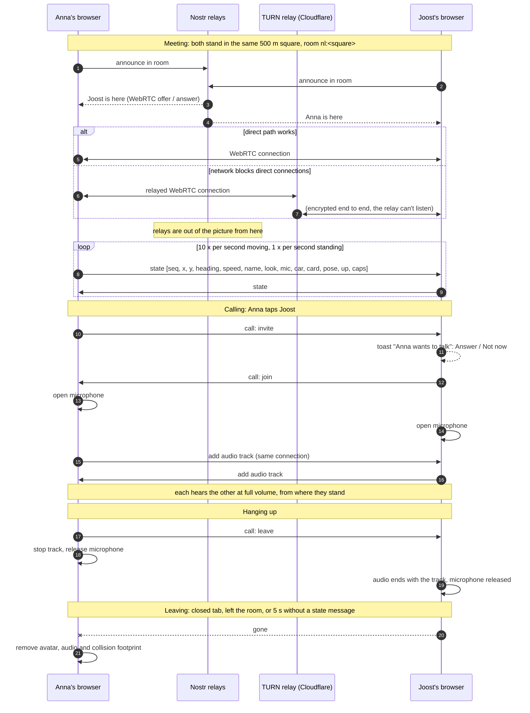

# Multiplayer: seeing and hearing each other

Status 2026-11-20: live on toycity.pages.dev and tested between a phone on a mobile network and a computer. There is no server of our own: the site is still only static files.

## Three independent systems

| System | Code | Knows about |
|---|---|---|
| Geographic streaming | `web/city.js` | buildings, roads and terrain. Nothing about other players. |
| Multiplayer presence | `web/mp/presence.js`, `players.js` | who is around, positions, names, personas and call messages. Nothing about audio or the map. |
| Spatial audio | `web/mp/voice.js` (voice), `web/mp/ambience.js` (environment) | microphone, proximity and positioning. Peers come through presence, and audio goes through a swappable transport. |

`web/mp/index.js` wires them together and draws the panel, the people list, the call bar and the toasts. `city.js` only calls `start()` and `update()`, which is about 25 lines including the helper that reports surroundings. `city.html?mp=0` turns the whole layer off.

All distances and rates are in `web/mp/config.js`.

## How players find each other (no backend)

1. The map is divided into **rooms** of 500 m squares on the Dutch RD grid. You join the square you're in. You also join a neighbouring square when you're within 20 m of its edge, and leave it again past 40 m. That way you can always see someone standing across the line.
2. Joining a room means announcing yourself on **public Nostr relays**, through the Trystero library. The relays are a meeting point only. They pass along the WebRTC offer and answer between two browsers, then they're out of the picture. The relay list is fixed in `config.js`, because everyone has to use the same relays to find each other. On 2026-11-20 several relays from the library's default list were down or refused anonymous visitors, so the list holds five that worked.

   Trystero is bundled locally (`web/mp/trystero-nostr.js`) with a small patch (`tools/trystero.patch`). Stock Trystero discards its connection offer about 4.8 s after making it. A connection that has to go through the TURN relay gathers its relay addresses for up to 5 s before answering, so the answer always arrived too late and phone-to-computer players never met. The patch keeps offers for 20 s and pre-builds 2 offers instead of 20.
3. From then on, everything travels **directly between browsers** over a WebRTC connection: positions over a data channel, and voice as an audio track on the same connection.

## Presence

- **Rooms are the RD square only** (`nl:<square>`), never the region name. Someone playing the Barendrecht map and someone on the Rotterdam map at the same spot are in the same room. Including the region slug once split players who had different maps open, and a friend never saw the other person.
- **State:** `[seq, RD x, RD y, heading, speed, name, look, mic]`. `look` is the persona and outfit, and `mic` says whether the microphone is on, so others see a 🔇 after a muted name. It's sent 10 times a second while moving, once a second while standing still, and immediately after a change or when someone joins.
- **Smoothing:** other players are drawn 150 ms in the past, between the two samples on either side of that moment. Late or duplicate samples (an older sequence number) are dropped.
- **Visibility:** everyone you hear about (your room and the neighbouring ones, roughly 250–500 m) is drawn as themselves, at their real size. Perspective makes them small far away, which is how a real street looks. Far-away people update their animation 5 times a second instead of every frame. (A big coloured dot for distant people was tried and rejected: it didn't look like a person.)
- **Leaving:** a player is removed when the room says they've gone, or after 5 seconds without an update. That cleans up their avatar, their voice and their collision footprint.
- **Avatars (personas):** each browser picks a persona and an outfit at random the first time and keeps it (`localStorage` `toycity.look`, or `?look=` for testing). There is no picker in the UI. Zuri (a Rigify character converted to Mixamo bone names by `tools/personas.py`) is the default, with garment colours varied per player; the classic figure is the fallback. Stacey (twisted hands after retargeting) and Billy (looked like a mannequin) are parked in `data/personas_wip`. Idle, walk and run animations are blended by speed; retargeting aligns rest-pose bone directions and leaves finger bones alone.
- **Names:** click your name in the panel to edit it in place. It's saved in the browser and sent with every update.
- **People are solid.** Other players are registered as live footprints in the collision registry (see [How it works](how-it-works.md#solid-things)), so you can't walk through them.

## Finding people

- **People list** (the people count in the panel): everyone in your rooms with their distance, a **Go** button that puts you a few metres from them, and a **Talk** button.
- **📍 Meeting link:** makes `city.html?meet=X,Y` for where you stand and shares it (the phone share sheet, otherwise the clipboard, otherwise a box to copy from). Everyone who opens it arrives on a random spot 2–4 m from that place, facing it, so a group spreads out instead of stacking on one point. Go uses the same `arriveNear()`.

## Voice: calls

Voice is **call-only**. Seeing someone never sends audio. (The first version sent your microphone to anyone within a few metres, which people found confusing: you couldn't tell who heard you.)

- **Starting a call:** `📞 Talk to <name>` buttons appear for people within 15 m. You can also tap the person, or use Talk in the people list. They get a toast with **Answer** / **Not now**. A ring gives up after 25 s.
- **Group calls:** inviting someone while in a call adds them. Everyone in the call hears everyone else in it.
- **In the call:** a bar shows who is in it and who is still ringing, with **Mute** and **Leave**. The microphone is opened only while a call is connected and released when it ends, so the browser's mic indicator matches reality.
- **How it sounds:** in a call, refDistance is set very large, so callers are heard at full volume wherever they stand, but still from their direction (HRTF). The listener ("ears") sits on your own head, 1.6 m up, turned with the camera. It used to sit on the camera, about 14 m behind the player, which made everyone inaudible.
- **Signalling:** invite, join, decline and leave travel on a `call` data-channel action sent straight to one player (`presence.sendTo`). `voice.js` asks `inCall(id)` to decide who gets my audio.
- There is **one connection per pair of players** and no separate voice link. The stream is added to the existing connection. Each microphone is sent raw, and mixing happens only in the listener's browser.
- **Talking indicator:** a ring under the speaker's feet lights up with their loudness. My own microphone button fills with my level.
- **Chrome quirk:** WebRTC audio only reaches Web Audio if the stream also feeds a muted `<audio>` element. A stream can also arrive a moment before its track does, so the code waits for the track.
- **Logs:** everything voice-related is logged with a `[voice]` prefix, with a summary every 5 s while anyone is near: mic level, who I'm sending to, who I hear and how loud. Leave these in: they found the listener bug.

### Connection lifecycle

## Background sounds

Made in the browser from noise and oscillators, with no files and no network:
- wind (gusting band of noise), always
- rustling leaves, more with more trees within 40 m
- bird chirps, more often where it's green
- low traffic rumble, louder near streets with many parked cars within 60 m

It starts with the first click (browsers require that) and has its own on/off button.

## Swapping in an SFU (for example LiveKit) later

Voice only talks to a transport with three functions: `send(peer, stream)`, `stop(peer, stream)` and `onStream(f)`. An SFU transport would publish the microphone once and subscribe to nearby speakers by id, while presence and the range rules stay exactly as they are.

What that needs, which is why it isn't done now:
- a small token service, because LiveKit room tokens are signed with a secret that can't live in a static site
- either a LiveKit Cloud project or a self-hosted server

Worth it once more than about 15–20 people gather in the same 500 m square, or for players whose networks block direct connections.

## Limits of the current version

- Everyone in a room connects to everyone else in it. That's fine for small groups, but it won't scale to crowds.
- About 1 in 10 networks block direct connections. Those players connect through Cloudflare's TURN relay instead (credentials from the `toycity-turn` Worker), which is slower to set up, so meeting someone can take up to half a minute.
- The public relays are run by other people and can be slow or go down. Five are used in parallel.
- Positions aren't checked by anyone, and mute and block are local only. Players connected directly can see each other's IP addresses.

## Testing

- `node --test tests/*.test.mjs` runs the unit tests: rooms and their hysteresis, smoothing including late and duplicate updates, heading wrap-around, visibility hysteresis, name cleaning, and the collision registry (circles, turned boxes, squares unloading, moving people, cell borders).
- End to end: open `city.html?fakemic=1` in two tabs. `fakemic` uses a beeping tone instead of a real microphone. Tap the other player, answer in the other tab, and each tab hears the other's tone.
- Relay-only: the Playwright scripts used during development override `RTCPeerConnection` with `iceTransportPolicy: 'relay'`, which forces the TURN path that phones on mobile networks take. Test this after any change to connection setup: it's the path that broke.
- Headless Chrome has `navigator.share`, so a test of the meeting link has to override `Navigator.prototype.share` to read the link.
